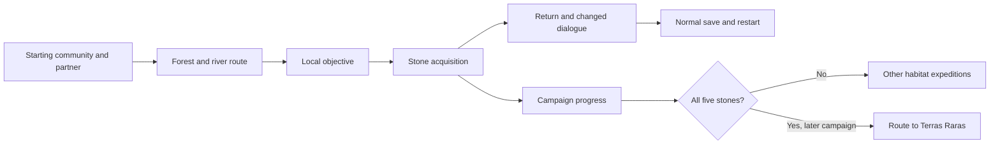

# Bichos do Brasil — Amazon expedition

Status: specified implementation proposal after formal review and bounded recheck; runtime implementation and acceptance evidence pending.

User decisions: five habitats and five key-item stones; Terras Raras endgame; Tio Sam and his extraction/control plot; original Brazilian replacement creatures; capybara, macaw and armadillo starter choice; new game required; first river-blockade mission.

## Overview

Bichos do Brasil is a creature adventure set across five Brazilian habitats. The player collects one rare stone in each to open the route to the Terras Raras, a hidden destination with prehistoric animals and fantastical allies capable of helping save the world.

Tio Sam, a fictional American capitalist seeking world domination, directs a corporation that exploits habitats and displaces creatures. He seeks access to the Terras Raras to control their powers. The player travels alongside Brazilian-animal-inspired creatures and helps communities resist the consequences of this plan.

The creature style balances recognizable animals with fantasy. Original silhouettes, habitats and restrained power motifs should establish a coherent visual identity across exploration and battles.

The first delivery should prove a complete small Amazon expedition before production expands to the remaining habitats. It should give the player a local reason to act, access to a partner, a reachable capture opportunity, a stone objective and a safe return with persistent progress. The proposed four-map boundary and three-species roster are specified in the authoritative implementation contract.

## The Problem

The current FireRed-based prototype changes houses, paths and selected dialogue. Trees, characters, interiors, battle creatures and other visible elements still retain the original game's identity. The protagonist also remains embedded in inherited opening scripts rather than a complete Brazilian adventure.

The next milestone must connect original visual assets with a playable beginning, objective and return. Merely adding illustrations or translating more text will not establish the intended experience. Developing all five habitats at once would multiply unfinished content before the basic production and progression loop is proven.

## Goals

1. Establish a recognizable Amazon setting through a consistent outdoor environment, essential interior, characters and battle presentation.
2. Introduce the five-stone journey and Tio Sam's threat through an understandable local conflict rather than unexplained exposition.
3. Give the player a Brazilian-animal-inspired partner and a reachable opportunity to battle and capture another creature.
4. Make the first stone obtainable exactly once, with clear acquisition feedback, a safe return route and persistent progress.
5. Demonstrate saving through the game menu, closing the emulator and resuming without losing the stone or creating inconsistent story state.
6. Produce a reproducible build and a cumulative patch verified independently against the clean FireRed revision 1 base.
7. Judge final assets at native GBA resolution in exploration, interior and battle scenes.

## Non-Goals for the First Delivery

The first delivery does not implement all five habitats, the Terras Raras destination or the final confrontation. They remain campaign goals, with early narrative foreshadowing.

It does not require an expanded evolution roster, multiplayer, simulated seasons, a new battle engine or a separate quest framework. A three-way starter selection is now explicitly required by the user; evolution scope remains open.

It does not promise compatibility with older prototype save files or emulator states. The save policy will be decided in the technical section rather than assumed here.

## Technical Plan (Architecture)

### Existing base and boundaries

Keep the existing FireRed revision 1 ROM project in `/workspace/pokefirered` as the current technical base. The browser prototype is not part of this implementation. Planning and release evidence are kept in `/workspace/teste`.

Reuse existing map loading, event scripts, battles, capture, inventory and saving. The campaign objective does not establish a need for a new engine, remote server or database. This section maps requirements to existing systems; it does not approve specific new numeric identifiers or select unresolved storage alternatives.

### Component responsibilities

| Component | Responsibility | Existing source area |
| --- | --- | --- |
| World content | Layout, collisions, entrances, objects, dialogue and encounters | `data/layouts/`, `data/maps/`, `src/data/wild_encounters*` |
| Region artwork | Terrain, vegetation, architecture, tile indices and palettes | `data/tilesets/`, `src/data/tilesets/`, `include/fieldmap.h` |
| Creature content | Original front/back/icon artwork, basic stats and moves | `graphics/pokemon/`, `src/data/pokemon/`, `src/data/graphics/` |
| Expedition events | Local mission, encounter with the corporation, stone grant and return feedback | Map scripts and `src/event_data.c` |
| Saved progression | Durable acquisition and story state | Existing flag/variable mechanisms and normal save system |
| Item representation, if selected | Stone names, descriptions, inventory placement and relevant icons | `include/constants/items.h`, `src/data/items.h`, item graphics/data |
| Delivery and evidence | Checked asset conversion, map rebuild, ROM generation, independent patch application and emulator route | Existing build system and project tooling, to be enumerated in Detailed Implementation |

Paths identify component areas, not the final exhaustive implementation file list. Detailed Implementation must enumerate every concrete file after remaining decisions are resolved.

### World and event flow

The Terras Raras node reserves a campaign requirement. The first milestone must not implement or claim an accessible endgame merely because the progression model accounts for it.

Map design must retain a safe return path after the objective and recovery after defeat. A river crossing may be represented by ordinary map connections or an event script; no dynamic boat physics is implied. The local challenge is the river blockade; the three-species starter and encounter roster is specified below.

### Replace inherited opening dependencies deliberately

Audit Pallet Town and the laboratory together: map transitions, coordinate events, scene variables, scripted movement, doors and partner grants. Existing Oak-related scripts must not accidentally start during the new expedition. A changed map layout alone is not a replacement story.

Preserve unaffected systems. List each retained or replaced opening event in the implementation plan. Test the resulting route from a new game, not just a state captured after the old opening.

### Stone acquisition and durable state

Allocate named progression identifiers only after checking their existing use. Do not assume a number is free because its constant has an anonymous-looking name. Define one authoritative acquisition state for each stone and derive the completion count from those five states.

The grant interaction must distinguish: prerequisites absent; eligible and not acquired; delivery failed; acquired; already acquired. Completion may only be set after successful delivery. Repeated interaction must not create duplicates. Dialogue and route checks must use the same authoritative state.

`data/maps/Route1/scripts.inc` provides an existing example of space checking, reward delivery and a persistent obtained flag. It is a reference pattern, not proof that a new stone event is already safe.

### Owner decision: how the stones are represented

The user selected Option A: key items in the bag, each with a name and description. The acquisition flag is authoritative for story progression; successful item delivery precedes setting that flag. The options below preserve the decision record.

| Option | Mechanism | Trade-off | Failure conditions to test |
| --- | --- | --- | --- |
| A: key items plus acquisition flags | Each stone appears in the bag. Its acquisition flag is authoritative for story gates; item delivery precedes setting completion. Stones cannot be sold, discarded or consumed. | Direct inventory visibility, but requires item slots, descriptions and keeping item presence consistent with progression. | Bag delivery failure, duplicate grants, missing item with completion set, accidental item consumption. |
| B: saved flags plus a dedicated progress display | Acquisition is stored in existing saved flags. A dialogue or progress screen displays which stones are held, without creating bag items. | Fewer inventory changes, but players need a clear place to see their five-stone progress. A custom screen adds interface work; dialogue is the smaller display. | Progress not discoverable, incorrect count/display, missing feedback after acquisition or reload. |

Neither option requires changing the serialized save-block structure on the evidence inspected so far. Exact identifiers and final UI behavior require later validation. The user selected new-game-only compatibility; ordinary saves must work within this release.

### Art integration and budgets

Build complete asset families: exploration tiles, character sprites and each creature's front/back/icon graphics. Maintain editable source art separately from indexed GBA outputs. Conversion must preserve transparent indices and document tile and palette assignments.

Current field-map limits in `include/fieldmap.h` are 1,024 total tile slots and 1,024 total metatiles, with 640 in the primary allocation; seven primary palettes and thirteen total map palettes are loaded. This leaves 384 secondary tile/metatile slots and six loaded secondary palette slots for an area. Report the actual usage and loaded palette references for each map instead of relying on image dimensions alone.

The existing artwork scripts use fixed offsets and input dimensions. Their process must be made reproducible from known clean inputs before scaling to further regions. Validate all preconditions before changing outputs, and regenerate map objects explicitly when binary layout dependencies would otherwise be missed.

### Normal saving and recovery

Keep normal menu saves distinct from emulator save states. The acceptance route must save, close the emulator process, reopen the final ROM with its ordinary save file and confirm partner, inventory or progress display, stone state, objective dialogue and accessible position.

The user selected a new-game-only release. Earlier prototype save files are unsupported; normal saves must work within this release. Cross-build emulator-state support is not an acceptance criterion.

### Build and delivery evidence

Pin the source and tool revisions and document an ordered clean-input build. Include source art conversion, binary map regeneration and final ROM generation. A stale object must not allow an older map to pass as the current design.

Create a cumulative patch against clean FireRed revision 1, SHA-1 `dd5945db9b930750cb39d00c84da8571feebf417`. Apply the released patch through a separate implementation and compare the resulting ROM hash with the build. If the ROM grows beyond the current IPS helper's equal-size, 16 MiB assumptions, decide the packaging change before releasing.

### Required critical journeys

- New game: receive mission and partner, traverse every required connection, encounter and capture, complete the local objective, obtain the stone and return.
- Duplicate reward: revisit the stone event before and after a normal save/restart; confirm one acquisition and coherent dialogue.
- Failed delivery, for Option A: refuse an unavailable inventory grant without consuming the reward or marking completion; retry successfully afterward.
- Defeat and recovery: return to an accessible recovery point with story state still consistent.
- Native-resolution art: inspect exploration, interior, creature front/back, party icon and battle backdrop on the final build.

These are future acceptance requirements. No test was executed during this drafting step.

## Alternatives Considered

These alternatives come from the concept brief's Alternatives Weighed section and the owner's stone-representation decision. Deferral applies to the first expedition, not to the confirmed five-habitat campaign ambition.

### Build all five habitats before validating one complete expedition

Benefit: the full world becomes visible sooner. Cost: every unresolved map, asset and progression issue spreads across five content sets. The working plan defers this approach in favor of one complete Amazon expedition that proves the production process and gameplay loop. The exact first-expedition roster and map caps remain open.

### Continue replacing only houses and isolated dialogue

Benefit: small edits produce quick visible changes. Cost: inherited trees, characters, interiors, battles and opening events retain the FireRed identity. This is insufficient for the user's stated visual goal. The first expedition instead needs a coherent set of visible assets across its full playable route.

### Switch the main implementation to the browser prototype

Benefit: easy browser access and fewer GBA asset restrictions. Cost: the current prototype lacks the existing ROM's complete map, event, battle and save systems; changing platform creates substantial new work. The current ROM-based direction remains the working base. A later platform change would require an explicit scope decision.

### Add a separate quest or collectible framework

Benefit: a dedicated interface could support a larger future campaign. Cost: it adds state and integration work before five collectible objectives have demonstrated a need for it. Existing saved flags, items and scripts can express the present requirement; audit and reuse them first.

### Earlier proposal to defer a starter trio and evolution chains

Benefit: early variety resembles the eventual collection experience. Cost: each species and stage requires front/back sprites, party icons, palettes, stats, moves and gameplay checks. The initial review recommended deferring this work. The user subsequently required a three-way starter choice, so the starter-trio deferral is superseded. The first milestone must cover all three starter asset families; expanded evolution chains remain deferred.

### Use emulator states as evidence of normal saving

Benefit: convenient, fast testing of later scenes. Cost: states can retain stale pointers across builds and bypass ordinary save serialization. They may assist diagnosis but cannot establish normal save/restart persistence. A separate ordinary-save acceptance route is required.

### Represent stones only through saved flags and a progress display

Benefit: fewer inventory changes; acquisition can remain in existing saved flags. Cost: a separate display or dialogue is needed for players to inspect their collection. The user explicitly chose named, described key items in the bag instead. Use saved acquisition flags to drive story gates while keeping the inventory representation consistent.

## Detailed Implementation Plan

All paths are relative to /workspace/pokefirered unless explicitly absolute. User-approved story decisions are separated from draft implementation values.

### Confirmed starting-partner selection

The user clarified that the player chooses a starting partner, as in Pokémon. This supersedes the earlier proposed one-partner production cap; that cap had not been user-approved. Use the three candidates just presented: capybara-inspired water partner, macaw-inspired fire partner and armadillo-inspired earth partner. Draft names, stats and moves are specified in Initial creature table; regional species references remain part of artwork research.

#### Required player experience

Before the first expedition, present three original creature choices. Each presentation shows the creature, its elemental identity and a short description of its style. Let the player inspect the choices, confirm one or return to selection. Confirmation grants exactly one partner and unlocks the starting expedition. Choosing again after confirmation must not grant another starter.

This reuses the familiar three-choice pattern without requiring the same professor, laboratory or presentation artwork as FireRed. The riverside introduction must fit the new story; exact scene writing remains part of the detailed quest design.

#### Production and testing impact

Produce three complete starter families: front sprite, back sprite, party icon, palettes, basic stats and an initial usable move set. The milestone also requires at least one reachable wild encounter suitable for the capture test; its encounter roster is defined in the authoritative implementation contract. Do not infer a fixed four-species roster until encounter design is decided.

Test each starter path from a fresh game: preview, cancellation, confirmation, exactly one grant, initial usable moves, first battle, return/healing and ordinary save/restart. Reopening the introductory event after confirmation or after loading must preserve the chosen partner and grant no duplicates. Scripted story gates should use the confirmed-choice state rather than assuming one species.

Do not automatically assign the rival a counter-starter, add evolutions or promise rock-paper-scissors balance from the three labels. Those are separate design choices. The user confirmed choice among the three animals, not every detail of FireRed's opening.

### Confirmed creature-integration direction: replace the original cast

The user's “11” is interpreted as Option 1, replacement. The intended game's visible roster consists of original Brazilian creatures. Production can replace assets incrementally, but each playable release must restrict its accessible encounters and trainer teams to the creatures actually completed. Do not call the whole roster replaced when only starters have been integrated.

#### Draft first-trio slot mapping

| Original slot | New creature inspiration | Initial type direction | Rationale |
| --- | --- | --- | --- |
| Squirtle | Capybara | Water | Keeps the existing water-starter slot while changing the complete creature identity. |
| Charmander | Macaw | Fire | Keeps the existing fire-starter slot while changing the complete creature identity. |
| Bulbasaur | Armadillo | Ground | Reuses the remaining starter slot; explicitly replaces its Grass/Poison typing and incompatible inherited moves. |

This is an implementation proposal for the confirmed replacement approach. The user chose the three animals and elemental directions, not their final names or stats. Do not silently retain the original rock-paper-scissors balance assumption: these types require an explicit early-game balance check.

#### Concrete starter asset files affected by the draft mapping

For each file below, replace the original artwork with the corresponding original Brazilian creature asset. Preserve the file's integration role and validate the converted output. Keeping legacy internal filenames does not authorize keeping legacy artwork.

| Creature | Front | Back | Icon | Footprint | Normal palette | Alternate palette |
| --- | --- | --- | --- | --- | --- | --- |
| Capybara | `graphics/pokemon/squirtle/front.png` | `graphics/pokemon/squirtle/back.png` | `graphics/pokemon/squirtle/icon.png` | `graphics/pokemon/squirtle/footprint.png` | `graphics/pokemon/squirtle/normal.pal` | `graphics/pokemon/squirtle/shiny.pal` |
| Macaw | `graphics/pokemon/charmander/front.png` | `graphics/pokemon/charmander/back.png` | `graphics/pokemon/charmander/icon.png` | `graphics/pokemon/charmander/footprint.png` | `graphics/pokemon/charmander/normal.pal` | `graphics/pokemon/charmander/shiny.pal` |
| Armadillo | `graphics/pokemon/bulbasaur/front.png` | `graphics/pokemon/bulbasaur/back.png` | `graphics/pokemon/bulbasaur/icon.png` | `graphics/pokemon/bulbasaur/footprint.png` | `graphics/pokemon/bulbasaur/normal.pal` | `graphics/pokemon/bulbasaur/shiny.pal` |

Apply matching names in `src/data/text/species_names.h`, typing and stats in `src/data/pokemon/species_info.h`, initial and later moves in the level-up tables, and compatible move permissions in the TM/HM and tutor tables. Review `src/pokemon_icon.c` for palette assignment and the previously enumerated picture/coordinate/palette tables for dimensions and positions. Verify the actual generated symbol references; not every table necessarily needs an edit if dimensions and bindings remain valid.

Update Pokédex content and inspect all dex-number/classification/description references before declaring each species complete. Prevent unfinished original evolution stages from appearing in the first milestone. Evolution chains remain deferred, so a creature must not evolve into an unchanged original Pokémon during the accessible demo.

#### Replacement acceptance matrix

For every starter, test preview, cancellation, confirmation, party icon, summary/name/type display, front/back battle rendering, usable initial moves, leveling behavior and normal save/reload. Check a repeated introductory interaction grants no duplicate. Audit accessible encounters and trainer parties for original Pokémon left visible. Verify any displayed footprint, Pokédex entry or alternate palette is either completed or deliberately inaccessible in the demo.

No existing source file has been changed by this planning decision. Save migration remains out of scope under the previously selected new-game policy.

### Detailed Implementation — proposed first playable expedition

This section turns the earlier inventory into a concrete delivery proposal for section review. User-confirmed choices remain: GBA ROM basis, new game required, replacement creatures, three selectable starters, key-item stones, five habitats, Terras Raras and Tio Sam's extraction/control plot. The route, dialogue roles and milestone choices below are proposed implementation detail, not newly claimed user approvals.

#### Playable boundary and quest

Reuse four existing map slots for a bounded expedition: Pallet Town becomes the riverside village and dock; Route 1 becomes its connected forest trail; Viridian Forest becomes the stone clearing and corporate blockade; the player's ground-floor house becomes the only accessible interior. Start a new game in that ground-floor interior, with coordinates validated against its revised layout. Block unused upstairs, rival-house, laboratory and unrelated world connections in both geometry and event data so the demo does not leak into unchanged content.

A local guide introduces the five-stone story and offers the three partners. A care NPC at the dock heals the party. The guide explains that the corporation's operation blocks a passage used by the community. The player follows the trail, meets wild creatures, confronts an agent at the clearing, and can operate a clearly identified shutdown control after winning. The cleared passage leads to the first stone. Return dialogue acknowledges the restored route and the stone. The next four habitats and Terras Raras are described as future destinations, not reachable unfinished maps.

Use a normal trainer battle and map-event changes for the confrontation; no machinery simulation is required. Losing returns the player to the starting community without setting victory or stone completion. Defeating the agent enables the shutdown control. Operating the control opens the passage to the stone; neither action awards the stone. Operating the control is repeat-safe. Acquiring the stone sets its completion only after successful inventory delivery.

Narrative name: Pedra das Águas. Inventory label: P. das Águas (12 encoded characters plus EOS, within the 14-byte field). This is a fictional item name, not a claim about Amazon geology. Final names of the other four stones can remain outside the accessible milestone; reserve their conceptual completion slots without distributing unavailable items.

#### Creature delivery boundary

Complete capybara/water, macaw/fire and armadillo/ground replacements in the three mapped starter slots. All three starter choices must be playable. Use those completed creature families for the milestone's wild encounters and the agent's party; the capture test does not require a fourth unfinished species. Do not grant the unchosen starters automatically.

Start partners at the existing level 5. Give each a reliable damaging move at that level; introduce elemental identity through a short early learnset using existing moves. Final stats, moves and names need an explicit balance/content table before production, rather than copying incompatible original typing. No old evolution may trigger in this milestone. The three elemental directions are not promised to form a symmetric advantage triangle.

#### Visual replacement boundary

Replace visible ground, riverbank, vegetation, houses/dock, the accessible interior, both selectable player appearances, the guide/care NPC/agent, creature front/back/icons and the grass battle backdrop. Audit action graphics used by the playable route, including receiving/using an item and the player's battle back sprite. Cycling, fishing and surfing are not unlocked in the milestone, avoiding a false promise that their legacy action sheets have been redesigned.

The title, inventory/party/battle window layout, sound effects and existing move animations may still use the base engine presentation in this first delivery; list that limit in the release. No full-game originality claim is justified by the first expedition. The closing formal review must evaluate whether the visible replacement boundary meets the user's initial visual goal.

#### Progress states and acceptance conditions

| State | Allowed action | Required result |
| --- | --- | --- |
| Partner not chosen | Inspect any starter and cancel | No grant or progression unlock |
| Partner confirmed | Revisit guide, save and reload | Same chosen partner; no extra starter |
| Agent undefeated | Battle or lose | Loss preserves access to healing and a retry |
| Agent defeated | Operate shutdown control | Passage opens once; victory survives normal save |
| Stone available | Interact with stone | Successful item delivery followed by acquisition completion |
| Stone delivery fails | Retry later | Reward remains available and completion remains unset |
| Stone acquired | Revisit, return, save/restart | No duplicate; stone in key-item pocket; consistent dialogue |

#### File manifest for the proposed route

All ROM paths are relative to `/workspace/pokefirered`. Each listed source is a planned edit unless stated otherwise. Generated intermediates are regenerated, not maintained as a second source of truth.

| Files | Change and reason |
| --- | --- |
| `src/new_game.c` | Start in the revised ground-floor house; remove reliance on the original bedroom introduction. |
| `data/maps/PalletTown/map.json`, `data/maps/PalletTown/scripts.inc`, `data/maps/PalletTown/text.inc` | Village objects, starter/guide/care interactions, dock feedback and removal of inherited Oak triggers. |
| `data/maps/Route1/map.json`, `data/maps/Route1/scripts.inc`, `data/maps/Route1/text.inc` | Forest route, instructions, encounters and connections within the demo boundary. |
| `data/maps/ViridianForest/map.json`, `data/maps/ViridianForest/scripts.inc`, `data/maps/ViridianForest/text.inc` | Blockade, agent, shutdown control, stone grant and repeat-safe return behavior. |
| `data/maps/PalletTown_PlayersHouse_1F/map.json`, `data/maps/PalletTown_PlayersHouse_1F/scripts.inc`, `data/maps/PalletTown_PlayersHouse_1F/text.inc` | Starting interior, appropriate opening dialogue, valid exit and removal of unused upstairs access. |
| `data/layouts/layouts.json` | Layout dimensions and tileset assignments for those four slots. |
| `src/data/region_map/region_map_sections.json` | Player-facing map names for the revised areas. |
| `include/constants/flags.h`, `include/constants/vars.h` | Audited named identifiers for chosen partner, local objective and stone progression. |
| `include/constants/items.h`, `src/data/items.json`, `src/data/graphics/items.h`, `src/data/item_icon_table.h` | Pedra das Águas key-item data and icon binding. Generated `src/data/items.h` is not hand-edited. |
| `graphics/items/icons/pedra_das_aguas.png`, `graphics/items/icon_palettes/pedra_das_aguas.pal` (create) | Original key-item icon and limited palette; confirm directory conventions before creating the bindings. |
| `src/data/wild_encounters.json` | Encounter tables containing only completed Brazilian creature replacements on the playable route. |
| `src/data/trainers.h`, `src/data/trainer_parties.h` | Fictional corporation agent identity and a party drawn from completed species. |
| `src/data/text/species_names.h`, `src/data/pokemon/species_info.h` | Names, types, stats and growth properties for the three replacements. |
| `src/data/pokemon/level_up_learnsets.h`, `src/data/pokemon/level_up_learnset_pointers.h`, `src/data/pokemon/tmhm_learnsets.h`, `src/data/pokemon/tutor_learnsets.h`, `src/data/pokemon/evolution.h` | Coherent moves and prevention of unfinished original evolutions. |
| `src/data/pokemon/pokedex_entries.h`, `src/data/pokemon/pokedex_text_fr.h`, `src/data/pokemon/pokedex_categories.h` | Consistent descriptive data when displayed; inspect generated/source relationships before editing. |
| `src/data/graphics/pokemon.h`, `src/data/pokemon_graphics/front_pic_table.h`, `src/data/pokemon_graphics/back_pic_table.h`, `src/data/pokemon_graphics/palette_table.h`, `src/data/pokemon_graphics/shiny_palette_table.h`, `src/data/pokemon_graphics/front_pic_coordinates.h`, `src/data/pokemon_graphics/back_pic_coordinates.h`, `src/data/pokemon_graphics/enemy_mon_elevation.h`, `src/data/pokemon_graphics/footprint_table.h`, `src/pokemon_icon.c` | Audit bindings, dimensions and icon palette references; edit only bindings whose replacement assets require it. |
| `src/data/object_events/object_event_graphics.h`, `src/data/object_events/object_event_pic_tables.h`, `src/data/object_events/object_event_graphics_info.h`, `src/data/object_events/object_event_graphics_info_pointers.h` | Bind character art and verify dimensions/palettes for walking and item actions. |
| `src/data/graphics/trainers.h`, `src/data/trainer_graphics/back_pic_tables.h`, `src/data/trainer_graphics/front_pic_tables.h` | Bind original player battle backs and agent trainer appearance. |

The eighteen starter artwork files are enumerated in the earlier starter asset table and form part of this manifest. Additional concrete map, tileset and visible-art file families follow.

- `data/layouts/PalletTown/map.bin` and `data/layouts/PalletTown/border.bin`: author the layout/collisions and consistent boundary tiles for this area.

- `data/layouts/Route1/map.bin` and `data/layouts/Route1/border.bin`: author the layout/collisions and consistent boundary tiles for this area.

- `data/layouts/ViridianForest/map.bin` and `data/layouts/ViridianForest/border.bin`: author the layout/collisions and consistent boundary tiles for this area.

- `data/layouts/PalletTown_PlayersHouse_1F/map.bin` and `data/layouts/PalletTown_PlayersHouse_1F/border.bin`: author the layout/collisions and consistent boundary tiles for this area.

- `data/tilesets/primary/general/tiles.png`, `data/tilesets/primary/general/metatiles.bin`, `data/tilesets/primary/general/metatile_attributes.bin`: artwork, metatile composition and movement behavior for the original regional set.
  Palette sources: `data/tilesets/primary/general/palettes/00.pal`, `data/tilesets/primary/general/palettes/01.pal`, `data/tilesets/primary/general/palettes/02.pal`, `data/tilesets/primary/general/palettes/03.pal`, `data/tilesets/primary/general/palettes/04.pal`, `data/tilesets/primary/general/palettes/05.pal`, `data/tilesets/primary/general/palettes/06.pal`. Audit assignments as a family; do not change unused palettes solely to fill the list.

- `data/tilesets/primary/building/tiles.png`, `data/tilesets/primary/building/metatiles.bin`, `data/tilesets/primary/building/metatile_attributes.bin`: artwork, metatile composition and movement behavior for the original regional set.
  Palette sources: `data/tilesets/primary/building/palettes/00.pal`, `data/tilesets/primary/building/palettes/01.pal`, `data/tilesets/primary/building/palettes/02.pal`, `data/tilesets/primary/building/palettes/03.pal`, `data/tilesets/primary/building/palettes/04.pal`, `data/tilesets/primary/building/palettes/05.pal`, `data/tilesets/primary/building/palettes/06.pal`. Audit assignments as a family; do not change unused palettes solely to fill the list.

- `data/tilesets/secondary/pallet_town/tiles.png`, `data/tilesets/secondary/pallet_town/metatiles.bin`, `data/tilesets/secondary/pallet_town/metatile_attributes.bin`: artwork, metatile composition and movement behavior for the original regional set.
  Palette sources: `data/tilesets/secondary/pallet_town/palettes/07.pal`, `data/tilesets/secondary/pallet_town/palettes/08.pal`, `data/tilesets/secondary/pallet_town/palettes/09.pal`, `data/tilesets/secondary/pallet_town/palettes/10.pal`, `data/tilesets/secondary/pallet_town/palettes/11.pal`, `data/tilesets/secondary/pallet_town/palettes/12.pal`. Audit assignments as a family; do not change unused palettes solely to fill the list.

- `data/tilesets/secondary/viridian_forest/tiles.png`, `data/tilesets/secondary/viridian_forest/metatiles.bin`, `data/tilesets/secondary/viridian_forest/metatile_attributes.bin`: artwork, metatile composition and movement behavior for the original regional set.
  Palette sources: `data/tilesets/secondary/viridian_forest/palettes/07.pal`, `data/tilesets/secondary/viridian_forest/palettes/08.pal`, `data/tilesets/secondary/viridian_forest/palettes/09.pal`, `data/tilesets/secondary/viridian_forest/palettes/10.pal`, `data/tilesets/secondary/viridian_forest/palettes/11.pal`, `data/tilesets/secondary/viridian_forest/palettes/12.pal`. Audit assignments as a family; do not change unused palettes solely to fill the list.

#### Tooling and evidence files

Under `/workspace/teste`, plan an explicit asset manifest `assets/amazon/manifest.json` and a build procedure `docs/amazon-build.md`. The manifest must list final source-art files, hashes, output paths and palette/tile assignments; it is not yet populated. Create a checked converter `tools/build_amazon_assets.py` that validates all inputs before producing outputs, and a release procedure `tools/build_amazon_release.sh` that rebuilds map dependencies and records hashes. These replace dependence on manually sequencing one-off visual experiments.

Extend `tests/emulator/runner.c` with ordinary-save handling. Create `tests/emulator/amazon_route.py` for the three starter branches and stone/capture/restart scenarios; keep its input sequence and expected progression checks explicit. Create `tests/test_amazon_assets.py` only for failure-prone constraints such as out-of-range tile/palette references and partial conversion, not to mirror every assignment.

Use `tools/build_ips.py` only if the final artifact meets its existing limits; independently apply the result before delivery. Produce `releases/amazon-demo/LEIA-ME.txt`, `releases/amazon-demo/validation.json` and a reviewed screenshot list after testing. None of these future outputs is claimed generated in this planning step.

### Detailed Implementation — content tables and completion proposal

The user approved the first mission: choose a partner, explore the forest, defeat a corporation agent, disable the river blockade, obtain Pedra das Águas and return. The specifications below complete the proposed initial content set for review. Names and numerical balance are draft design values, not claims of playtested balance.

#### Initial creature table

Stat order is HP / Attack / Defense / Special Attack / Special Defense / Speed. All three use medium-fast growth, base friendship 70, catch rate 45 and base experience 64 for this milestone; these are proposed balance values. No evolution is enabled in the first delivery.

| Working name | Inspiration / slot | Type | Stats, total 310 | Ability | Moves known at level 5 | Next move at level 8 |
| --- | --- | --- | --- | --- | --- | --- |
| Capivágua | Capybara / Squirtle | Water | 60 / 40 / 65 / 55 / 55 / 35 | Torrent | Tackle, Water Gun | Tail Whip |
| Ararafogo | Macaw / Charmander | Fire | 45 / 55 / 40 / 65 / 35 / 70 | Blaze | Peck, Ember | Growl |
| Tatupedra | Armadillo / Bulbasaur | Ground | 60 / 60 / 75 / 30 / 60 / 25 | Battle Armor | Tackle, Mud-Slap | Defense Curl |

Use existing move mechanics. Each species must receive its damaging moves at levels at or below 5 through the actual learnset so a normal grant initializes them. Macaw appearance does not silently add Flying typing or a ground immunity. Keep all three starting branches winnable; adjust draft numbers if measured tests reveal a clearly failing branch and record that change for review.

The forest route offers the three completed species at levels 2–4. The agent has one level-4 Ararafogo and one level-4 Tatupedra; no held items. The guide grants five capture items once. A repeatable free care interaction is available at the village dock, including before a retry after defeat. Initial progression must not require capturing a particular species.

#### Characters and visible art

Use the existing female and male walking/item-action bindings for original player designs. Redesign the woman_1 binding as the local guide, fat_man as the care provider and scientist as the corporation agent. These are internal reuse choices, not descriptions of the final character bodies or roles. The story does not require Oak, a rival battle or a laboratory.

Planned exact character artwork edits:

- `graphics/object_events/pics/people/red_normal.png`, `graphics/object_events/pics/people/green_normal.png`, `graphics/object_events/pics/people/red_item.png`, `graphics/object_events/pics/people/green_item.png`: original player walking and item actions.
- `graphics/object_events/palettes/player.pal`, `graphics/object_events/palettes/player_reflection.pal`: coherent player and reflected colors.
- `graphics/object_events/pics/people/woman_1.png`, `graphics/object_events/pics/people/fat_man.png`, `graphics/object_events/pics/people/scientist.png`: guide, care provider and agent.
- `graphics/object_events/palettes/npc_green.pal`, `graphics/object_events/palettes/npc_white.pal`: the corresponding shared NPC palettes; validate all NPCs visible in the demo together.
- `graphics/trainers/back_pics/red_back_pic.png`, `graphics/trainers/back_pics/leaf_back_pic.png`, `graphics/trainers/palettes/red_back_pic.pal`, `graphics/trainers/palettes/leaf_back_pic.pal`: original player presentation when sending out a creature.
- `graphics/trainers/front_pics/scientist_front_pic.png`, `graphics/trainers/palettes/scientist.pal`: the agent in battle.
- `graphics/battle_terrain/grass/terrain.png`, `graphics/battle_terrain/grass/terrain.bin`, `graphics/battle_terrain/grass/terrain.pal`, `graphics/battle_terrain/grass/anim.png`, `graphics/battle_terrain/grass/anim.bin`: the forest battle background and its entry transition. Keep the battle terrain consistent across the route and agent encounter.

The final source-art manifest is `/workspace/teste/assets/amazon/manifest.json`; author original editable source files under `/workspace/teste/assets/amazon/` with the same basenames as the output assets and unique family directories (`characters/`, `creatures/`, `terrain/`, `items/`). Record an explicit source/output pair for every converted image. No downloaded illustration may be called integrated until its indexed output has been displayed in the game.

#### Event-state allocation and binding procedure

Use named identifiers for partner confirmation, corporate-agent defeat, blockade shutdown, village return acknowledgment and five stone acquisitions. Reuse the existing saved starter selection variable where its references are audited; store the selected species explicitly rather than deriving it from which graphic was clicked.

Before assigning numeric values, search constant definitions and all script/C references, exclude temporary flags, trainer-flag ranges and engine-reserved ranges, and create a checked allocation record at `/workspace/teste/assets/amazon/identifiers.json`. The implementation must fail validation on a collision. Choosing free numbers after this audit is a mechanical allocation step; expanding a save block is not authorized by this plan.

The agent trainer identifier follows the same audit process; add its named entry in the actual trainer-ID source after confirming how that header/table is generated. Do not assume `include/constants/trainers.h` owns individual trainer identifiers merely because it owns class and portrait constants. The binding check below resolves this source to include/constants/opponents.h; the reference audit remains mandatory.

#### Quest conditions

Partner confirmation grants exactly one level-5 creature and the one-time capture supplies, then enables leaving the village. Preview/cancel does not change durable state. The blockade cannot be shut down before the agent defeat; the stone cannot be reached through a collision or warp shortcut before shutdown. A failed stone grant leaves the interaction available.

After acquisition the stone is a non-consumable, non-sellable, non-discardable key item. The acquisition flag drives narrative progress. Repeated stone interactions show completion text without awarding another item. The guide acknowledges the player on return and explains that four stones still remain. No warp to an unfinished habitat or Terras Raras is activated.

All five stone flags are reserved for the campaign model; only Pedra das Águas is obtainable in this milestone. A test may set flags in a separate controlled fixture to verify a five-stone predicate, but that fixture must not be confused with a full campaign playthrough or a released shortcut.

#### Concrete verification plan

1. Validate authored asset indices, map bounds, palette slots, collision/warp coordinates, creature table lengths and identifier allocations before building.
2. Rebuild from the recorded clean source plus the planned changes, explicitly regenerating map objects; verify final map bytes and converted assets correspond to the manifest.
3. Create the cumulative patch, independently apply it to the known clean base and require exact equality with the compiled ROM hash.
4. Run three fresh-game paths, selecting a different partner each time. For each, test preview/cancel, confirm, repeat interaction, first battle, capture, healing, agent defeat, shutdown, stone acquisition and return.
5. Test losing the agent battle, returning safely and winning on retry. Test repeated agent/control/stone interactions before and after normal save/restart.
6. Test a deliberately failed item grant with a controlled fixture; confirm no completion flag and a successful later retry. Keep this diagnostic fixture separate from normal gameplay evidence.
7. Save with the game menu, terminate the emulator and reopen using only the ordinary save file. Confirm the chosen partner, captured party, stone, local objective state and valid player position.
8. Inspect screenshots at 240×160 for player/NPC actions, interior, outdoor transitions, all three creatures' front/back/icon graphics, battle background and key-item display. Record audio as untested unless actually checked.
9. Produce `/workspace/teste/releases/amazon-demo/validation.json` with final hashes and individual pass/fail/unrun outcomes, plus `/workspace/teste/releases/amazon-demo/LEIA-ME.txt` specifying a clean base and new game. Evidence images use descriptive filenames listed in the validation record.

### Trainer binding check completed

Read-only inspection located the individual trainer identifiers in `include/constants/opponents.h`. `TRAINER_BUG_CATCHER_RICK` is ID 102 and already drives the forest event; its corresponding record is in `src/data/trainers.h`. For the bounded demo, replace that accessible trainer record and event with the corporation agent, change its displayed name/class/portrait, and bind its party to the completed Brazilian species. Audit all references to ID 102 before reuse and document any occurrence outside the unreachable demo boundary. No increase to the trainer-ID range is needed for this proposed route.

Add `include/constants/opponents.h` to the audited manifest; a semantic alias may be added for readability while retaining ID 102. The trainer source-binding prerequisite above is now resolved. Numeric event allocations still require the prescribed collision check during implementation, and the final design remains subject to the independent formal review.

## Reconciliation and review provenance

The previous brief's single-partner cap and starter-trio deferral were recommendations superseded by the user's explicit three-starter choice. New-game-only saves, inventory stones, replacement species and the river-blockade mission are user-confirmed updates. No contradiction with those decisions was identified. The detailed roster values, reused map slots and asset families are proposals approved for review, not playtested facts. Earlier brainstorm review predates the full story and is not a substitute for this readiness review.

No production files changed during design. The independent review must verify source bindings, completeness of the file list, testability and whether any consequential decision remains unresolved.

## Readiness corrections — authoritative requirements

These corrections resolve source-grounded findings from the first formal readiness pass and supersede earlier ambiguous wording. They do not claim the whole design has passed review.

### Startup and defeat recovery

Initialize `setrespawn HEAL_LOCATION_PALLET_TOWN` on the starting 1F transition before any battle; the original 2F initialization is no longer reachable. Retain the house recovery contract at (8,5) with the NPC local ID `LOCALID_MOM` at (8,4). Redesign that NPC as the community caregiver using the same completed caregiver art as the dock NPC. Keep those positions walkable and face the caregiver toward the recovered player.

Add `src/data/heal_locations.json`, `src/heal_location.c` and `data/scripts/white_out.inc` to the explicit audit manifest. Preserve the existing recovery data/coordinates unless inspection reveals an inconsistency; replace Mom-specific dialogue/choreography with the caregiver's appropriate recovery interaction. The outdoor dock provides voluntary healing, while defeat returns to the house. Test defeat from a fresh game before any optional healing interaction; this catches the missing-startup-checkpoint failure.

### Starter encoding and grant transaction

Keep `VAR_STARTER_MON` as its existing index: 0 armadillo/Bulbasaur slot, 1 capybara/Squirtle slot, 2 macaw/Charmander slot. Do not store a species ID in that variable. Existing `GetStarterSpeciesById` readers in `src/field_specials.c` continue to work with the unchanged slots; no second species variable is required. Use a separate audited acquisition flag to distinguish an unchosen partner from index zero.

After successful partner delivery, record the index and chosen flag, set `FLAG_SYS_POKEMON_GET` to enable the party menu, then deliver the capture supplies through a separately guarded one-time interaction. If supplies cannot be added, leave their flag unset and allow a retry without another partner grant. Pokédex access is deferred in this milestone; party/summary access is required. Validate grant success before completing the relevant state.

### Stone label and validation

Keep the full narrative name in dialogue and description; use the abbreviated bag label P. das Águas. Validate encoded byte length including EOS for all item and creature names, not Unicode character count alone. Do not expand ITEM_NAME_LENGTH globally. The exact item-slot and complete JSON record must be resolved before implementation; icon files alone are not a complete definition.

### Buildable work phases

1. Startup, recovery and sealed map boundary: build and boot a fresh game, verify the checkpoint and safe recovery before changing the creature engine.
2. Map/event loop using clearly temporary assets: validate partner confirmation, blockade states, single grant and return through the planned map graph.
3. Creature and item data integration: validate all three partner branches, encounters, item pocket behavior and no legacy evolutions.
4. Final authored-art conversion: validate manifest, tile/palette allocations, transitions and both sides of battle graphics.
5. Release validation: build from pinned inputs, independently apply the patch, run ordinary-save/restart scenarios and record native-resolution evidence.

A phase is not complete because the ROM builds. Its stated behavioral checks must pass before moving forward.

### Remaining readiness work

The independent reviews still require exact map dimensions/connections/warps/events/metatile assignments, complete stone data binding, completed learnsets and encounter weights, and a populated art/conversion manifest. Pin concrete build and independent patch-application commands, and the ordinary-save runner interface. These are implementation-plan gaps, not missing credentials or platform permissions. This document remains NOT implementation-ready until they are resolved and reviewed.

## Concrete contract added after readiness findings

See [amazon-implementation-contract.md](amazon-implementation-contract.md) for authoritative map coordinates, connections, recovery contract, item record, starter encoding, encounters, asset constraints and phased tooling requirements. Earlier unresolved wording is superseded by that contract where explicit. Independent patch-tool acquisition and the final authored art still require execution-time evidence; neither is claimed completed.

## Review closure

The original and follow-up reports are implementation_readiness_report.md and readiness_recheck_report.md. The authoritative contract supplies the subsequent source-grounded clarifications. Earlier readiness failures are historical, not silently converted to reviewer passes. Execute the five implementation phases and retain separate pass/fail/unrun evidence for each.
